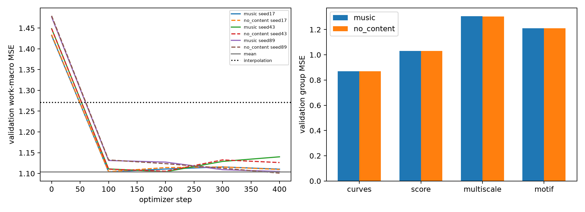

# Goal 4：有限规模Transformer无标签预训练验证

日期2026-10-13。执行与数值复算完成（implemented / locally reproduced）；音乐学习解释仍为preliminary。结论：**本轮没有通过自监督表征晋级门槛，暂不把这些权重作为已证明有效的下游初始化。** 这不证明Transformer或自监督不可行，只否定本轮输入/遮挡/重建设计在登记预算下的稳定收益。

## 做了什么

42首可用作品以seed20261014固定划分为30首训练、8首验证、4首保留且不加载。每作品使用整曲清单中前2个演奏，共60条训练和16条验证序列；同一作品所有演奏同属一个集合。归一化只用训练作品真实有效值。验证是开发集：用于选最佳checkpoint，且某些作品此前参与过smoke开发，因此不是独立终审。

模型沿用Goal 3整曲Transformer：58→64线性投影、动态正弦余弦位置、2层编码模块、每层4头、前馈128、末端LayerNorm、四组线性重建头，共74,734参数。正式有限验证设dropout0.1、Adam恒定学习率0.001、梯度裁剪1.0，按128拍长度桶组batch≤2，补齐到当前批最大长度，不裁成64拍。

三种seed17/43/89，每种各训练正常音乐输入、去音乐内容控制，共6次，每次400次更新，总计2400次。两个条件的初始化、训练顺序、遮挡样本指纹与有效拍曝光量核验一致。训练每次重新采样约12%的不相邻连续4～8拍片段；验证用独立随机流固定3个遮挡视图，所有模型与基线共用这些视图。

正常模型看局部演奏与谱面上下文。为防泄漏，提前缓存的多尺度与全曲动机输入整列隐藏，拍位与质量标记也隐藏；被遮挡片段另有4拍保护区。四组有效内容依然重建。去内容控制把所有可见音乐值清零，保留相同位置、补齐与token规则。均值基线输出训练均值；插值基线只读可见且真实观测的值，完全隐藏的派生列回退训练均值。

## 主要结果

数值为标准化特征重建MSE，越低越好，**不是乐句准确率、百分比正确率或F1**。先平均同作品演奏与遮挡视图，再等权四组和作品。

| 方法 | seed17 | seed43 | seed89 |
|---|---:|---:|---:|
| 正常模型初始 | 1.432139 | 1.448379 | 1.476701 |
| 正常模型最佳验证 | 1.103981 | 1.104160 | 1.104845 |
| 去内容模型最佳验证 | 1.104505 | 1.105441 | 1.100838 |
| 正常模型推理时清零内容 | 1.104679 | 1.106259 | 1.120327 |
| 训练均值控制 | 1.103929 | 1.103929 | 1.103929 |
| 可见值插值控制 | 1.270705 | 1.270705 | 1.270705 |

正常模型比初始化明显降低loss，但没有稳定超过均值。相对于受训去内容模型，三个seed的相对差值分别为+0.047%、+0.116%、−0.364%（正值代表正常内容更好），均未满足预登记的至少2%门槛。**门槛通过0/3。** 即使正常模型优于这里的插值控制，也不能据此认定音乐表征有效，因为均值更强。

## 哪些特征奏效，哪些没有

| 重建组 | 正常模型（三seed平均） | 去内容模型 | 均值 | 插值 |
|---|---:|---:|---:|---:|
| 演奏曲线 | 0.869682 | 0.869965 | 0.862572 | 1.197540 |
| 谱面线索 | 1.031746 | 1.031000 | 1.021550 | 1.353687 |
| 多尺度曲线 | 1.305953 | 1.304091 | 1.309665 | 1.309665 |
| 动机关系 | 1.209933 | 1.209324 | 1.221928 | 1.221928 |

多尺度与动机相对均值有小幅改善，但去内容模型同样做到，不能归因于利用音乐上下文。演奏和谱面两组反而不及均值。逐特征复算覆盖43个非元数据重建维度：少数重复关系特征相对均值改善约2%～4%；休止时长、力度差分、音符活动密度等没有改善。例如休止时长误差比均值高约4.05%，力度差分高约3.53%。这些是开发探索差值，未作多重检验或证明可泛化。



左图各条件在约100步后落到均值附近，此后没有一致改善；右图四组正常/去内容模型几乎重合。`learning_curves.csv`的train_loss是检查时最近一个训练batch的损失，不是训练集宏平均，不同batch不可直接解释成平滑训练曲线；每组验证曲线可直接比较。

## 病因判断：证据与尚未证明的部分

1. **直接观测：模型主要学到了接近先验的输出。** 去掉音乐后仍获得几乎相同结果，解释了为什么loss下降不等于获得有用音乐表征。正常模型推理清零内容有少量损害，尤其seed89，说明不是完全忽视内容，但这种依赖没有形成稳定的验证优势。
2. **设计限制：为防泄漏，输入上下文信息损失明显。** 多尺度与动机共23个语义维度全隐藏，而它们占四组等权loss的一半；局部遮挡还有4拍保护区。模型需要恢复原始全曲派生目标，却看不到对应分支。这是已存在的设计限制，尚未通过单因素消融证明它是主要病因。
3. **任务限制：手工统计回归与音乐关系并不等价。** 谱面输入是逐拍统计，不能完整呈现音符序列、声部和原始动机。以MSE预测异质统计值容易接近均值；增加层数或步数不能自动补回丢失的信息。这里的推断仍需目标设计对照验证。
4. **预算限制：只做了400次更新与30首作品。** 不能排除更多更新、其他学习率或更大曲库的收益。但100→400步没有一致改善，当前证据不支持不加诊断地继续延长训练。

没有使用任何乐句标签，因此标注主观性不是本轮负结果的原因，也没有计算边界F1。

## 文献核对与可借鉴方向

本轮读取了下列原论文摘要页，未完整复现其算法，也未把论文成绩移作项目成绩：

- [MERT](https://arxiv.org/abs/2306.00107)：音乐音频自监督用RVQ-VAE声学教师与CQT音乐教师提供训练目标，并在音乐下游任务评估。可借鉴“训练目标应保留音高等音乐信息”；它的原始音频、大规模数据与教师目标和我们的58维统计MSE不同，不能直接宣称复制MERT就会解决断句。
- [MAE](https://arxiv.org/abs/2111.06377)：图像遮挡重建采用只处理可见patch的编码器及轻量解码器，摘要报告高遮挡比例的有效性。可借鉴“遮挡任务和可见信息共同设计”；图像patch与音乐拍级统计不同，不能照搬75%遮挡率。

据本地结果推断，优先修正输入和目标的一致性：只保留不会泄漏的可见音乐关系，或从遮挡后的原始事件重算派生输入；先证明可见内容比均值/无内容控制更有用，再讨论扩大模型。该方向为proposed，本轮未新增调参实验。

## 三个诊断问题的答案

1. 干预是否改变了预期行为？改变了，正常模型保留内容、控制模型清零内容；训练样本、mask与曝光量相同，直接推理消融有数值影响。
2. 收益是否来自音乐？当前没有稳定证据；两个受训条件都下降到均值附近，主要改善可被无内容控制解释。43个语义列评分，元数据和常数列已排除，下降不是重建缺失标记本身造成。
3. 什么会推翻这个解释？若修正后的输入/目标在相同作品划分和预算下稳定超过均值及无内容控制，并改善下游Scratch对照，就支持确实利用音乐。当前负结果只适用于本轮协议。

## 验收与资源

全项目22项自动测试通过。独立NumPy脚本复算6个检查点保存的验证输出及两个基线，主要指标最大差异1.17×10⁻⁸；验证目标和mask逐字节一致；按作品三集合无交集；4首保留作品缓存未读取；原始访问仅76个允许的beat_time/beat_dyn文件。所有6次400步实验均完成，没有无限调参。

训练脚本含数据加载、验证、图表等累计38.05秒，使用RTX5070Ti；PyTorch峰值allocated约52.79MiB，这不是整卡总占用或reserved显存。每seed每条件曝光约25万有效拍，控制配对一致。人工编码、测试与报告时间另计。

关键证据：`registered_protocol.json`、`run_summary.csv`、`learning_curves.csv`、`group_summary.csv`、`feature_summary.csv`、`validation_masks.json`、`raw_source_access.csv`、`cache_access.csv`、`independent_audit.json`。保存预测位于`predictions/`，6份检查点在`checkpoints/goal4_pretrain/`。此前Goal 1～3产物保留。

复算命令（项目目录）：

```powershell
& '..\phrase_boundary_overnight\.venv\Scripts\python.exe' -m src.goal4_audit
& '..\phrase_boundary_overnight\.venv\Scripts\python.exe' -m unittest discover -s tests -v
```

本Goal执行完毕，结论为负；暂不进入“自监督已有效”的下游验证结论。
